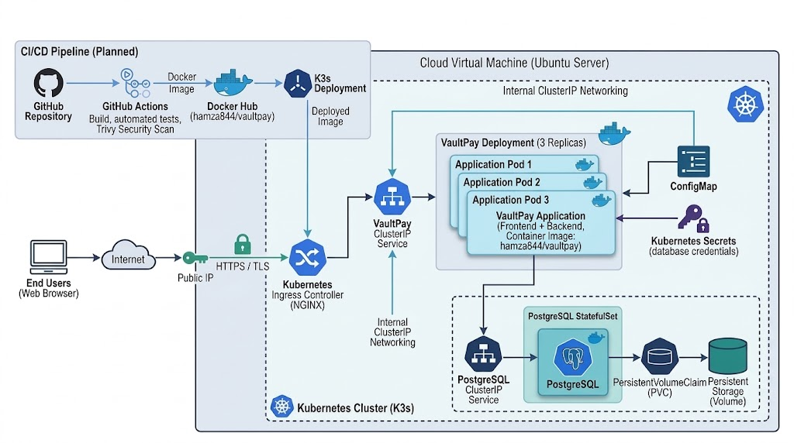

 *** Architecture  for DevOps Engineer ***
# VaultPay

Single Node.js app (Express + React/Vite/TypeScript) on port 3000, backed by PostgreSQL via `pg`.

## Run locally
1. Start any PostgreSQL 13+ and create the database/user in `.env.example`.
2. `cp .env.example .env` (export the variables, or pass them to your container/Pod).
3. `npm install && npm run build && npm start` → http://localhost:3000
   - Dev mode with hot reload: `npm run dev` (Vite on :5173 proxies `/api` to :3000).

## Configuration (env vars)
`PORT`, `JWT_SECRET`, `AUTO_INIT_DB`, `DATABASE_URL` or `PGHOST` `PGPORT` `PGUSER` `PGPASSWORD` `PGDATABASE`.

The schema lives in `sql/*.sql` (idempotent). The app applies it on startup unless `AUTO_INIT_DB=false`;
you can also run it once with `npm run db:init` or mount `sql/` into Postgres' init directory.
The app retries the DB connection for ~60s, so it tolerates Postgres starting later.

## API
`POST /api/auth/register|login` · `GET|PUT /api/profile` · `GET /api/dashboard` · `GET /api/transactions[?direction=&q=]`
· `GET /api/transactions/:id` · `POST /api/transfers` · `GET /api/health` (for probes)
